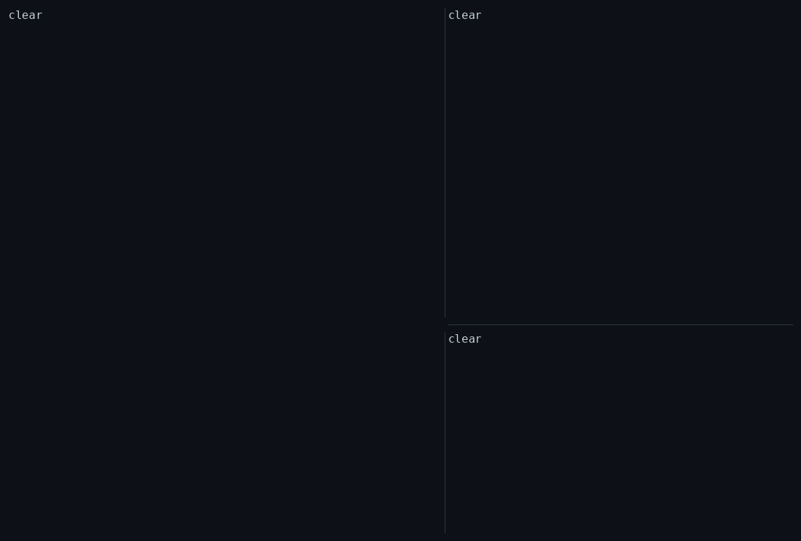

# ura-chatroom

A terminal chat room written in [ura](https://github.com/ura-computing/ura-lang): one server, as many clients as you like, rooms, emojis, dice, a magic 8-ball, rainbow text and a spinning donut.

<p align="center">
  
</p>

## Run it

```bash
git clone https://github.com/ura-computing/ura-chatroom && cd ura-chatroom
ura deps install

ura run-server                # terminal 1, listens on port 6667
ura run-client                # terminal 2, joins #lobby as guest
ura run-client                # terminal 3, joins as guest2
```

Build only with `ura server` and `ura client`, then pick a nick and a port yourself: `./build/client alice 6667`, `./build/server 6667`.

## In the chat

| type | what happens |
|---|---|
| any text | everyone in your room sees it, with your nick in its own color |
| `/nick name` | change your name |
| `/join room` | move to another room (created on the fly) |
| `/dice` `/flip` | the server rolls a die or flips a coin for the room |
| `/8ball question` | the magic 8-ball answers, for the whole room |
| `/rainbow text` | your text in rainbow colors |
| `/donut` | a spinning ASCII donut in your terminal; the room sees you eating it |
| `/help` | the list above |
| `/quit` | leave |

Emoji shortcodes become emojis for everyone: `:fire:` 🔥 `:heart:` ❤ `:donut:` 🍩 `:rocket:` 🚀 `:tada:` 🎉 `:smile:` 😄 `:laugh:` 😂 `:thumbsup:` 👍 `:wave:` 👋 `:coffee:` ☕. Emojis typed directly work too.

## How it works

One server process watches the listening socket and every client with `poll()`, so nobody waits for anybody. Client and server talk in plain text lines:

| client to server | server to client |
|---|---|
| `HELLO nick` | `WELCOME nick room` (a taken nick becomes `nick2`) |
| `SAY text` | `MSG room nick text` |
| `JOIN room`, `NICK name` | `INFO text` (joins, leaves, renames) |
| `DICE`, `FLIP`, `ASK question` | `BOT room text` |
| `RAINBOW text` | `RAINBOW room nick text` |
| `DONUT`, `QUIT` | `ERROR text` |

You can talk to the server without the client too: `nc 127.0.0.1 6667`, then `HELLO bob` and `SAY hi`.

## The ura in it

The project is also a tour of the language:

| feature | where |
|---|---|
| `mod` | `net`, `log`, `banner`, `emoji`, `fun`, `donut`, `protocol` |
| `enum` + `match` | `enum Kind` and the command dispatch in `server/commands.ura` and `client/show.ura` |
| `try` / `throw` / `catch` | every command runs in a `try`; a bad one throws an `Error` that becomes an `ERROR` line |
| `operator $` | `User` and `Room` format themselves in logs: `{user}`, `{room}` |
| `operator =`, `operator []`, `operator drop` | copying users and rooms, `room[i]`, the server closes its socket on drop |
| `template<T>` | the donut's `Grid<T>` |
| `unic` | the emoji table and the donut notice (`'🍩'`) |
| `$"..."` strings | every line on the wire and on screen |
| multi-line strings | the `/help` text |
| `String`, `Array<T>` | read buffers, poll lists, socket addresses: no raw buffers |
| `@if os` | the socket address layout and `SO_REUSEADDR` differ on macOS and Linux |
| `os::argv` | nick and port from the command line |

```
src/
  server.ura + server/      the server: poll loop, commands, extras
  client.ura + client/      the client: run loop, typed commands, display
  chat/user.ura, room.ura   User and Room, each with methods.ura and operators.ura
  protocol.ura              enum Kind, split, kind_of
  net.ura log.ura banner.ura emoji.ura fun.ura donut.ura
```
